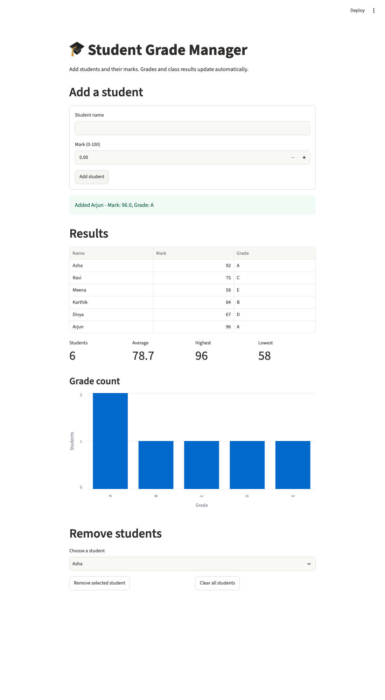

# Python Basics

Small Python projects I built while learning the language. Each folder is a
self-contained program you can run on its own.

## Projects

### [grade-manager](grade-manager/)
A terminal app that stores student marks, works out each grade (A–E), and
prints an aligned results table with the class average, highest and lowest
mark. Invalid input (blank names, duplicates, marks outside 0–100, text
instead of numbers) is handled without crashing.

Uses only plain Python, nothing to install.

```bash
cd grade-manager
python grade_manager.py
```

### [cricket-score](cricket-score/)
Fetches live cricket scores from Cricbuzz with [Playwright](https://playwright.dev/python/).
The scores are loaded by JavaScript after the page opens, so the script drives
a real browser, waits for the score cards to appear (no fixed sleeps), prints
every live match, and saves a screenshot as `score.png`. If no match is live,
it says so instead of failing.

```bash
cd cricket-score
python3 -m venv venv
source venv/bin/activate          # Windows: venv\Scripts\activate
pip install -r requirements.txt
playwright install chromium

python cricbuzz_score.py              # opens a browser window
python cricbuzz_score.py --headless   # runs without a window
```

### [streamlit-grade-manager](streamlit-grade-manager/)
The grade manager again, but as a web page built with
[Streamlit](https://streamlit.io/) instead of a terminal menu. A form adds
students and marks, and the page shows a results table with grades (A–E),
the class average, highest and lowest mark, and a bar chart of how many
students got each grade. You can remove one student or clear the list.
Blank names and duplicate names are rejected, and the mark box only accepts
numbers from 0 to 100.

```bash
cd streamlit-grade-manager
python3 -m venv venv
source venv/bin/activate          # Windows: venv\Scripts\activate
pip install -r requirements.txt

streamlit run app.py              # opens http://localhost:8501
```



The same folder also has [api.py](streamlit-grade-manager/api.py), a small
[FastAPI](https://fastapi.tiangolo.com/) app I practised with. It returns
JSON instead of a web page and manages an in-memory to-do list (list, view,
add, update and delete tasks). It runs on its own, separate from the
Streamlit page:

```bash
fastapi dev api.py                # then open http://127.0.0.1:8000/docs
```

## What I practised
- Lists, dictionaries, functions and loops
- Validating user input and handling errors
- Formatting output with f-strings
- Browser automation and waiting for dynamic content with Playwright
- Building a REST API with FastAPI: path and query parameters, request
  bodies with Pydantic models, and HTTP status codes
- Building a web UI in pure Python with Streamlit: forms, tables, metrics,
  charts, and `st.session_state` to keep data between reruns
